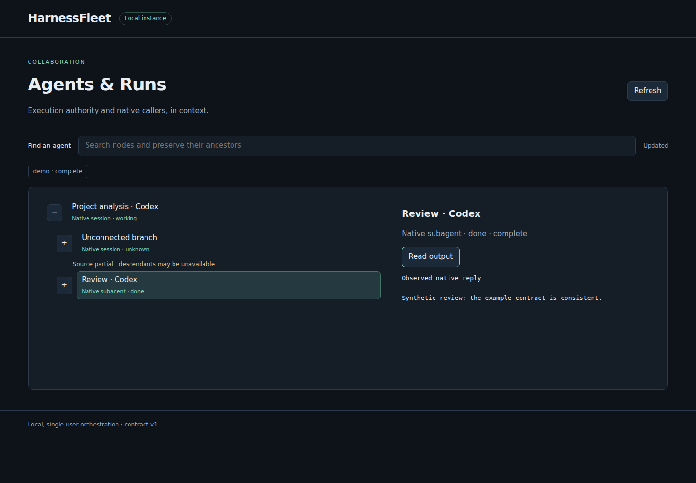

# HarnessFleet

Delegate bounded work between local agent harnesses, await verified results, and
inspect managed runs alongside connected native sessions.

HarnessFleet is a local, single-user Python package. It owns execution receipts,
policy, capacity and generation history; your native CLIs own authentication.
The dashboard binds to `127.0.0.1:8421`. It can close without stopping workers.

This is an alpha implementation of the [product specification](docs/specification.md).
The [support matrix](docs/support.md) separates deterministic tests, native evidence
and capabilities that remain disabled. A successful synthetic demo is not native certification.



## Install and try it

Python 3.11+ is required. Linux/WSL with pidfds is required for execution.

```sh
python -m pip install ./harnessfleet-0.1.0a1-py3-none-any.whl
harnessfleet --version
harnessfleet demo
```

The offline demo writes synthetic data in a new temporary directory and prints the
exact dashboard command. It needs no native CLI, account, credential or model call.
Use `harnessfleet demo --serve` to open the demo server directly.

For development, `python -m pip install -e '.[dev]'` installs test tools.

## Connect your own Routes

```sh
harnessfleet init
harnessfleet doctor
harnessfleet service start
```

Initialization creates a configuration with no Routes, no connected native stores,
no project discovery and no delegation grant. It never imports another tool's configuration.
Set `HARNESSFLEET_CONFIG` and `HARNESSFLEET_STATE` for an isolated instance; defaults
follow XDG configuration and state directories. Credentials stay in native accounts
or explicitly referenced environment variables. [Configuration examples](docs/configuration.md)
show how to enable your own policy without copying secrets.

Install and authenticate the native CLI yourself. Doctor runs only executable and
native authentication diagnostics, never a prompt. Missing tools and authentication
remain explicit. No account, provider or billing fallback occurs.

## Delegate

Install the common skill explicitly in a directory read by the selected harness:

```sh
harnessfleet integrate --harness claude_code --directory /your/project/.claude/skills
harnessfleet integrate --harness codex_cli --directory /your/project/.agents/skills
harnessfleet run routes --diagnose
harnessfleet run start --route codex-local --model YOUR-MODEL -C /your/project 'Read the contract and report inconsistencies.'
```

Then use `harnessfleet run follow ID` and `harnessfleet run output ID`. All CLI
responses are contract-v1 JSON. Follow blocks on file notifications and returns a
failure exit code when no successful result is available. Output validates the
completion receipt and digest. Partial evidence is available with `--partial` and
never authorizes replay. The same operations are available through
`from harnessfleet import RunManager`.

A required set uses `run batch --targets ... --selection '{"required":[...]}'`.
An allowed set uses `"allowed"`. The orchestrator resolves natural-language intent;
the core checks the exact targets. Every required target has a run or an explicit
failure. See [public contracts](docs/contracts.md).

Capacity refusal is immediate unless `--queue` is requested. `run cancel ID`
cancels queued work; `run dispatch` revalidates policy and capabilities before launch.
`service start` runs the optional local queue controller; `service stop` stops only
that instance's demonstrably owned controller, leaving workers intact.

## Inspect and recover

```sh
harnessfleet dashboard
harnessfleet run list
harnessfleet run events ID
harnessfleet run stop ID
harnessfleet run recover
```

The tree expands and paginates without a fixed depth or node cutoff. Filtering
retains ancestors. Connected source failures and partial branches remain explicit.
Observed sessions remain read-only. Connect only explicitly selected source exports.

[Recovery](docs/recovery.md) explains uncertain ownership, generation fencing,
continuation and retention. [Plugins](docs/plugins.md) describes the public adapter
contract. [Compatibility](docs/compatibility.md) records the later private-wrapper
migration boundary. `agent-run` compatibility is opt-in and refuses to overwrite an
existing command. There is no `hf` command.

## Test

```sh
python -m pytest
ruff check src tests
python -m build
```

Tests install fake native executables and use temporary configuration and state.
They do not require operator accounts or production data. Native qualification is
a separate opt-in activity; evidence and tested versions are recorded in the support
matrix. Browser tests need `python -m playwright install chromium`.

MIT licensed. Extraction provenance is recorded in [NOTICE](NOTICE).
